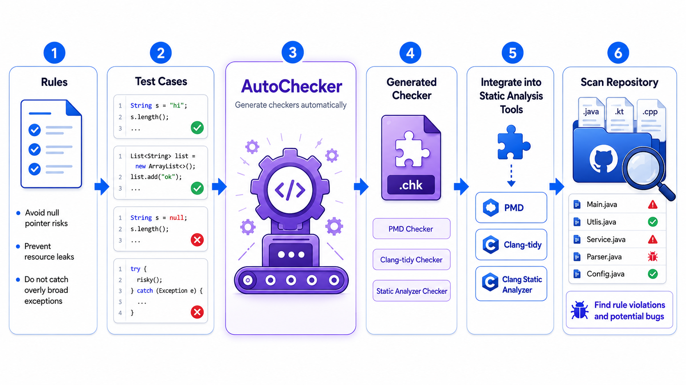

<p align="center">
  
</p>

<p align="center">
  <strong>From Specs and Patches to Checkers</strong>
</p>

<p align="center">
  Automatically turn coding standards in documents and security knowledge in vulnerability patches into static code checkers that can scan real code
</p>

<p align="center">
  <a href="./README.md"></a>
  <a href="./README-cn.md"></a>
  <a href="https://github.com/SQUARE-RG/AutoChecker/blob/master/LICENSE"></a>
</p>

---

# AutoChecker

> **From Specs and Patches to Checkers.**

**AutoChecker is an LLM-powered intelligent static code checker generation system. It automatically transforms natural-language coding standards, code test cases, and vulnerability patches into executable checkers for mainstream static analysis tools.**

> **You define what to check; AutoChecker implements how to check it.** From requirement understanding and checker generation to compilation, validation, and iterative repair, AutoChecker makes custom static checker development substantially easier.

### News

- 🎉 **Two real-world vulnerabilities discovered by AutoChecker-generated checkers have received CVE identifiers: [CVE-2026-103754](https://www.cve.org/CVERecord?id=CVE-2026-103754) and [CVE-2026-71364](https://www.cve.org/CVERecord?id=CVE-2026-71364).**
- 🔍 **AutoChecker-generated checkers have discovered and reported 16 vulnerabilities across 13 open-source repositories, all confirmed by project maintainers.**

### Why AutoChecker?

Static analysis tools such as CodeQL, Clang-Tidy, and PMD provide many built-in checks, but these checks cannot cover every organization-specific coding standard, project-specific constraint, or newly emerging vulnerability pattern.

When existing checks are insufficient, developers generally have to implement new checkers manually. This requires knowledge of program-analysis techniques—including abstract syntax trees, control flow, and data flow—as well as familiarity with the APIs and implementation model of each static analysis framework. **Even adding a single check may require substantial development and debugging effort.**

**AutoChecker removes the need to implement every checker from scratch.** Whether the goal is to turn a coding standard into an automated check or extract reusable detection logic from a vulnerability fix, AutoChecker generates the corresponding checker and improves it through validation and iterative repair in a real toolchain.

### What Can AutoChecker Do?

AutoChecker provides two complementary checker-generation approaches for different software quality and security needs.

| Generation approach | What you provide | What AutoChecker does |
| --- | --- | --- |
| **Generate from specifications** | A natural-language rule description plus compliant and violating code examples | Generates checkers for tools such as Clang-Tidy, CodeQL, PMD, and Semgrep, turning coding standards into executable checks |
| **Generate from vulnerabilities** | A CVE or vulnerability description, its patch, and the relevant source repository | Analyzes the root cause and generates a CodeQL security checker, turning a historical vulnerability into reusable detection capability for similar defects |

Both approaches follow an **automated generation, real-world validation, and feedback-driven repair** workflow. AutoChecker invokes the target static analysis tool to compile and test each candidate, then iteratively repairs compilation errors, false negatives, and false positives before returning the validated checker and its test results.

### Typical Use Cases

- **Operationalizing coding standards**: transform natural-language rules from national or industry standards and open-source secure coding guides into executable checkers.
- **Organization- and project-specific checks**: rapidly generate custom checkers for internal frameworks, specialized APIs, business security constraints, and team conventions that existing tools do not cover.
- **Vulnerability variants and similar-defect detection**: analyze a CVE and its patch, extract the vulnerability mechanism, and generate a reusable security checker for finding related defects in other repositories.
- **Continuous code quality and security assurance**: integrate generated checkers into code review, CI/CD, and security scanning workflows so custom checks continuously protect the development process.

### How Does AutoChecker Work?

AutoChecker turns checker development—traditionally performed by static analysis experts—into an AI-driven automated workflow.

For **specification-and-test-case-driven generation**, AutoChecker first interprets the natural-language rule and its compliant and violating examples to extract the relevant detection conditions. It then retrieves APIs and implementation knowledge for the target static analysis framework, generates a candidate checker, and validates its behavior through compilation and test execution. If compilation fails or a false negative or false positive occurs, the system uses the feedback to repair the checker until it satisfies the validation conditions or reaches the configured iteration limit.



For **vulnerability-and-patch-driven generation**, AutoChecker starts from vulnerability information and its patch, explores the relevant source code, and analyzes the trigger conditions, root cause, and repair mechanism. It converts the findings into a structured vulnerability specification and uses it to generate a CodeQL checker. The system validates the checker on the vulnerable and fixed program versions, then uses matching feedback from key predicates to locate and repair errors in its detection logic.

Ultimately, AutoChecker outputs checker code for the target static analysis tool, turning **coding standards and historical vulnerability knowledge into sustainable, reusable automated detection capabilities**.

### Key Advantages

- **No need to write checkers from scratch**: use natural language, code examples, or historical vulnerabilities as input and automate detection-logic analysis, checker generation, and validation.
- **Knowledge-enhanced intelligent generation**: combine Logic-Guided Knowledge Retrieval (LGKR) with Agentic RAG to obtain relevant static analysis APIs, analysis operations, and implementation examples on demand.
- **Real-toolchain validation and automatic repair**: compile and execute candidates in actual static analysis environments, then use test feedback and Differential Predicate Probing (DPP) to diagnose and repair problems.
- **Multiple languages and analysis engines**: generate checkers for Clang-Tidy, Clang Static Analyzer, CodeQL, and Semgrep across C/C++, Java, Python, JavaScript, TypeScript, and Rust, with additional PMD checker generation support.
- **Reusable detection capabilities**: apply the same specification to different static analysis tools or transform experience from historical vulnerability fixes into reusable security checkers.

## Installation Guide

AutoChecker currently provides two installation methods:

- **Manual installation**: install dependencies, configure environment variables, and build manually. This mode can be used to generate checkers for `PMD`, `clang-tidy`, `CodeQL`, and more.
- **Docker deployment**: use Docker to complete environment setup and toolchain preparation in one step. This mode currently supports generating `clang-tidy` and `CodeQL` checkers.

### Manual Installation

#### Environment Requirements

| Item | Requirement |
| --- | --- |
| Disk Space | At least 64 GB |
| Memory | At least 16 GB |
| CPU | At least 4 cores |
| Operating System | Ubuntu 22.04 (recommended) |
| LLM API Key | An API key for a large language model is required, such as DeepSeek or OpenAI |

#### Step 1: Prepare the Environment

Clone the repository:

```bash
git clone https://github.com/SQUARE-RG/AutoChecker.git
```

Create a virtual environment and install dependencies:

```shell
# Create a virtual environment
conda create -n autochecker python=3.10
conda activate autochecker

# Enter the project root directory
cd AutoChecker
pip install -r requirements.txt
```

#### Step 2: Install Static Analysis Engines

Install the required static analysis engines according to your needs:

1. [Deploy PMD](/doc/pmd_install_cn.md)
2. [Deploy clang-tidy](/doc/clang_tidy_install_cn.md)
3. [Deploy CodeQL](/doc/codeql_deploy_cn.md)
4. [Deploy Semgrep](/doc/semgrep_deploy_cn.md)

#### Step 3: Configure the LLM

Create a `.env` file in the project root directory and fill in your LLM API information:

```env
API_KEY=your_api_key
MODEL=model_name (e.g. deepseek, gpt-4)
BASE_URL=api_endpoint (e.g. https://api.deepseek.com)
```

After the configuration is complete, you can move on to preparing rules and test cases.

#### Step 4: Prepare Rules and Test Suites

Create a `rule.json` file in the project root directory:

```json
{
    "data": {
        "ucassaat": [
            {
                "main_title": "use-uncheck-pointer-after-malloc",
                "description": "The rule requires that any pointer obtained through dynamic memory allocation functions (such as malloc, calloc, or realloc) must be checked for non-null before its first use. This check must occur before the pointer is used; performing the check after use is considered a violation. Acceptable check methods include explicit or implicit null pointer comparisons like if (ptr != NULL), if (ptr), or if (!ptr). If a dynamically allocated pointer is never used, it does not violate this rule. If a pointer is reallocated, it must be checked again before any subsequent use. This rule applies equally to global and local variables. Only one warning should be reported per violating pointer variable.",
                "rule_test_path": "/root/code_check/experiment/gjb8114/codeql_test_case/use_uncheck_pointer_after_malloc"
            }
        ]
    }
}
```

Notes:

- `rule_test_path` must be an absolute path pointing to the directory of the test suite.
- For violating test cases, use `CHECK-MESSAGES` comments in the code to mark the expected results.

#### Step 5: Run

```shell
python src/main.py --rule_file rule.json --language cpp --analyzer clang-tidy
```

The generated results are saved to the `result-generation` directory by default.

---

### Docker Deployment

#### Environment Requirements

| Dependency | Description |
| --- | --- |
| Docker | Version 28.1.1 or later is recommended |
| Operating System | Ubuntu 22.04 is recommended, though other Linux distributions should also work |
| LLM API Key | An API key for a large language model is required, such as DeepSeek or OpenAI |

#### Step 1: Clone the Project

```bash
git clone https://github.com/SQUARE-RG/AutoChecker.git
cd AutoChecker
git clone https://github.com/llvm/llvm-project.git --branch release/17.x --depth 1
```

#### Step 2: Build the Docker Image

The build process automatically installs the Python runtime, configures the `conda` virtual environment, downloads embedding models, and builds the related static analysis toolchains. The entire process typically takes around 10 minutes.

```bash
docker build -t autochecker:1.0 .
```

> The build process includes dependency installation and compilation, so please wait patiently. When you see `Successfully tagged autochecker:1.0`, the build has completed successfully.

#### Step 3: Create and Start the Container

```bash
docker run -it --name autochecker-container autochecker:1.0 /bin/bash
```

After execution, you will enter the container's interactive shell, with the default working directory set to the AutoChecker root directory.

#### Step 4: Configure the LLM

Inside the container, create a `.env` file in the project root directory and fill in your LLM API information:

```env
API_KEY=your_api_key
MODEL=model_name (e.g. deepseek, gpt-4)
BASE_URL=api_endpoint (e.g. https://api.deepseek.com)
```

After the configuration is complete, you can move on to preparing rules and test cases.

#### Step 5: Prepare the Rule File

Create a `rule.json` file in the project root directory and fill in your rule definition and test case path:

```json
{
    "main_title": "your_rule_name",
    "title": "short_rule_summary (optional)",
    "description": "Describe in detail what this rule is intended to detect and in what scenarios it applies.",
    "rule_test_path": "/absolute/path/to/test/case/directory/",
    "category": "rule_category (optional)"
}
```

Test case requirements:

- Use the file extension corresponding to the target language, such as `.cpp`, `.c`, or `.java`.
- Each test file should be independently compilable.

#### Step 6: Start Generation

```bash
python src/main.py --rule_file rule.json --language cpp --analyzer clang-tidy
```

The program prints progress information during execution. After generation finishes, the results are saved to the `result-generation/` directory by default, including:

- `final_checker/`: the final generated checker code, such as header and implementation files.
- `checker_generation_result.json`: the performance report of the checker on the test suite, including metrics such as accuracy, time cost, and usage cost.

#### Step 7: Integrate the Generated Checker

The generated checker code can be placed directly into the checker directory of the target static analysis tool and used after recompilation.

## Currently Supported Static Analysis Tools

AutoChecker's two checker-generation approaches accept different inputs and target different detection goals, so they have different tool and language coverage.

### Specification-and-Test-Case-Driven Checker Generation

This approach takes a natural-language rule description plus compliant and violating test cases as input. It targets coding standards, project-specific constraints, and custom quality checks.

| Static analysis tool | Supported languages | Generated artifact | Current status |
| --- | --- | --- | --- |
| PMD | Java | Java checker | Supported; see the [PMD deployment guide](doc/pmd_install_cn.md) |
| Clang-Tidy | C/C++ | C++ checker source code | Supported; see the [Clang-Tidy deployment guide](doc/clang_tidy_install_cn.md) |
| CodeQL | C/C++, Python | CodeQL query | Supported; see the [CodeQL deployment guide](doc/codeql_deploy_cn.md) |
| Semgrep | C/C++, Java, Python, JavaScript, TypeScript, Rust | Semgrep YAML rule | Supported; see the [Semgrep deployment guide](doc/semgrep_deploy_cn.md) |
| Clang Static Analyzer | C/C++ | Clang Static Analyzer checker | Experimental; installation and a unified execution interface are still being improved |

### Vulnerability-and-Patch-Driven Checker Generation

This approach takes vulnerability information, a repair patch, and the source code before and after the fix as input. It analyzes the vulnerability's trigger conditions, root cause, and repair mechanism to generate a security checker for similar defects.

| Static analysis tool | Supported languages | Generated artifact | Current status |
| --- | --- | --- | --- |
| CodeQL | Java | CodeQL security query | Supported, including differential validation on vulnerable and fixed versions |

“Supported” means that the repository contains the corresponding generation and validation implementation. “Experimental” means that a prototype has been implemented and evaluated, while its engineering interface or deployment documentation still requires improvement. Not all backends currently share a single command-line entry point; read the relevant deployment guide and source entry point before running one. To improve an existing backend or add another static analysis tool or language, see the [Developer Guide](doc/Developer_Guide.md).

## Configuration

The `config.json` file in the project root directory can be adjusted as needed:

| Parameter | Description | Default Value |
| --- | --- | --- |
| `max_round` | Maximum number of iteration rounds for each test case | 2 |
| `max_compiler_trys` | Maximum number of attempts to fix compilation failures | 5 |
| `top_key` | Number of most relevant code snippets retrieved | 2 |
| `result_dir` | Output directory for generated results | result-generation/ |

## Citation

If you use our work in your research or project, please consider citing:

1. Jun Liu, Yuanyuan Xie, Jiwei Yan, Jinhao Huang, Jun Yan, Jian Zhang. Write Your Own CodeChecker: An Automated Test-Driven Checker Development Approach with LLMs. ICSE 2026. [paper](https://hanada31.github.io/pdf/ICSE2026_AutoChecker.pdf)

```bibtex
@inproceedings{AutoChecker,
      title={Write Your Own CodeChecker: An Automated Test-Driven Checker Development Approach with LLMs},
      author={Jun Liu and Yuanyuan Xie and Jiwei Yan and Jinhao Huang and Jun Yan and Jian Zhang},
      booktitle={Proceedings of the International Conference on Software Engineering (ICSE)},
      year={2026}
}
```

## Maintainers and Contributors

AutoChecker is actively developed and maintained by members of [SQUARE Research Group](https://square16.org/):

- Jun Liu([@nonsense-j](https://github.com/nonsense-j))
- Yuanyuan Xie([@xyyusr](https://github.com/xyyusr))
- [Liqiang Ji](https://carlson-jlq.github.io/liqiang-ji.github.io/) ([@carlson-jlq](https://github.com/Carlson-JLQ))
- Jinhao Huang ([@jinhao-huang](https://github.com/jinhao-huang))
- Yuyang Xie ([@sisifuCha](https://github.com/sisifuCha))
- Xianglong Qi ([@Meiosis-Poor](https://github.com/Meiosis-Poor))
- [Jiwei Yan](https://hanada31.github.io/)([@hanada31](https://github.com/hanada31))

## Contributing

AutoChecker is an open source project, and contributions from the community are welcome.
For more details, please refer to the [Developer Guide](/doc/Developer_Guide.md).

## Star History

[](https://star-history.com/#SQUARE-RG/AutoChecker&Date)
